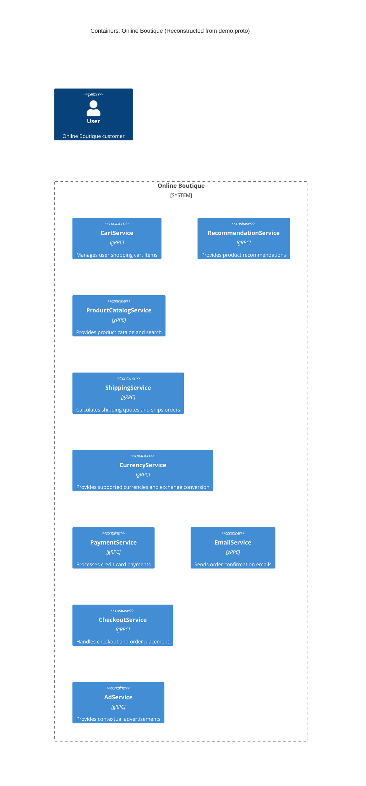

# Task 1A: Architecture Recovery

## 1. Agent

- **Product:** Antigravity
- **Model:** Gemini 3.8 Flash

---

## 2. Files Read

- `prompts/1-recover-architecture.md`
- `system/online-boutique/protos/demo.proto`

---

## 3. Containers Table

| Name | Technology / Language | Responsibility | Evidence (file path) |
| --- | --- | --- | --- |
| `CartService` | gRPC / Protocol Buffers (`syntax = "proto3"`) (implementation language not evidenced) | Manages shopping cart items (adding items, retrieving cart contents, emptying cart) | `system/online-boutique/protos/demo.proto:23-27` |
| `RecommendationService` | gRPC / Protocol Buffers (`syntax = "proto3"`) (implementation language not evidenced) | Computes and lists recommended product IDs based on user ID and viewing history | `system/online-boutique/protos/demo.proto:56-58` |
| `ProductCatalogService` | gRPC / Protocol Buffers (`syntax = "proto3"`) (implementation language not evidenced) | Provides product catalog data, single product lookup by ID, and product search functionality | `system/online-boutique/protos/demo.proto:71-75` |
| `ShippingService` | gRPC / Protocol Buffers (`syntax = "proto3"`) (implementation language not evidenced) | Calculates shipping price quotes based on address and cart items, and processes order shipping to generate a tracking ID | `system/online-boutique/protos/demo.proto:107-110` |
| `CurrencyService` | gRPC / Protocol Buffers (`syntax = "proto3"`) (implementation language not evidenced) | Returns list of supported currency codes and converts monetary amounts between currencies | `system/online-boutique/protos/demo.proto:140-143` |
| `PaymentService` | gRPC / Protocol Buffers (`syntax = "proto3"`) (implementation language not evidenced) | Authorizes and charges payments against credit cards, returning transaction IDs | `system/online-boutique/protos/demo.proto:177-179` |
| `EmailService` | gRPC / Protocol Buffers (`syntax = "proto3"`) (implementation language not evidenced) | Formats and sends order confirmation notifications/emails given order result data | `system/online-boutique/protos/demo.proto:199-201` |
| `CheckoutService` | gRPC / Protocol Buffers (`syntax = "proto3"`) (implementation language not evidenced) | Coordinates customer checkout and order placement | `system/online-boutique/protos/demo.proto:224-226` |
| `AdService` | gRPC / Protocol Buffers (`syntax = "proto3"`) (implementation language not evidenced) | Serves contextual text advertisements and redirect URLs based on context keywords | `system/online-boutique/protos/demo.proto:243-245` |

---

## 4. Dependencies Table

| Caller → Callee | Protocol | Evidence (file path and symbol / env var) |
| --- | --- | --- |
| *None evidenced* | *None evidenced* | *Not evidenced in the provided files* |

> **Note on Dependencies:** The only evidence file provided (`system/online-boutique/protos/demo.proto`) defines interface specifications (service and RPC definitions, plus message schemas). It does not contain runtime client invocation code, endpoint configurations, environment variables, or network targets. Therefore, no runtime dependencies (caller → callee) are evidenced in this file. (See **Gaps** for details.)

---

## 5. Mermaid Diagram

---

## 6. Gaps

The following architectural aspects cannot be determined solely from `system/online-boutique/protos/demo.proto`:

1. **Frontend / Web UI Container:**
   - *Gap:* There is no definition of a frontend web server, mobile gateway, or UI container in `demo.proto`. How end users (`Person`) interact with these gRPC services is completely missing.
   - *Extra file to settle:* `system/online-boutique/kubernetes-manifests/frontend.yaml` or `src/frontend/`.

2. **Runtime Dependencies / Call Graph:**
   - *Gap:* While data models indicate potential logical connections (e.g., `PlaceOrderRequest` and `SendOrderConfirmationRequest` both handle `OrderResult`; `CartItem` is shared across `CartService` and `ShippingService`), `demo.proto` contains no client invocation code or service address bindings showing which service calls which at runtime. For example, whether `CheckoutService` orchestrates calls directly to `PaymentService`, `EmailService`, `ShippingService`, `CartService`, and `CurrencyService`, or whether an unevidenced frontend coordinates them, cannot be determined.
   - *Extra file to settle:* `system/online-boutique/kubernetes-manifests/` (environment variables like `*_SERVICE_ADDR`) or service implementation source code (e.g., `src/checkoutservice/`, `src/frontend/`).

3. **Data Stores and Persistence:**
   - *Gap:* No data stores (`ContainerDb`), caches (e.g. Redis), or stateful persistence layers are declared in `demo.proto`. It is unknown whether services like `CartService` or `ProductCatalogService` use relational databases, NoSQL stores, or in-memory state.
   - *Extra file to settle:* `system/online-boutique/kubernetes-manifests/` (e.g., `redis.yaml` or database manifests) or `src/cartservice/`.

4. **Implementation Languages and Frameworks:**
   - *Gap:* `demo.proto` declares `syntax = "proto3"` and `option go_package`, which specifies Go code generation packages, but it does not evidence the actual programming languages (e.g., Go, C#, Java, Python, Node.js) used to implement each container.
   - *Extra file to settle:* `src/*/Dockerfile` or source directories under `src/`.

5. **External Systems and Third-Party Integrations:**
   - *Gap:* `PaymentService` and `ShippingService` could interact with external third-party payment gateways (e.g. credit card processors) or shipping APIs, but no `System_Ext` integrations are declared in protobuf contracts.
   - *Extra file to settle:* Implementation source code in `src/paymentservice/` and `src/shippingservice/`.

6. **Network Ports, Protocols at Runtime, and Ingress:**
   - *Gap:* Port numbers, transport encryption (plaintext gRPC vs. TLS/mTLS), load balancing, and ingress routing are absent from protobuf interface contracts.
   - *Extra file to settle:* `system/online-boutique/kubernetes-manifests/`.
