# Recovered Architecture: Online Boutique (Run B)

## 1. Agent

- **Product Name:** Antigravity (Gemini Code Assist)
- **Model:** Gemini 3.8 Flash (High)

---

## 2. Files read

- `prompts/1-recover-architecture.md`
- `system/online-boutique/protos/demo.proto`
- `system/online-boutique/kubernetes-manifests/README.md`
- `system/online-boutique/kubernetes-manifests/adservice.yaml`
- `system/online-boutique/kubernetes-manifests/cartservice.yaml`
- `system/online-boutique/kubernetes-manifests/checkoutservice.yaml`
- `system/online-boutique/kubernetes-manifests/currencyservice.yaml`
- `system/online-boutique/kubernetes-manifests/emailservice.yaml`
- `system/online-boutique/kubernetes-manifests/frontend.yaml`
- `system/online-boutique/kubernetes-manifests/kustomization.yaml`
- `system/online-boutique/kubernetes-manifests/loadgenerator.yaml`
- `system/online-boutique/kubernetes-manifests/paymentservice.yaml`
- `system/online-boutique/kubernetes-manifests/productcatalogservice.yaml`
- `system/online-boutique/kubernetes-manifests/recommendationservice.yaml`
- `system/online-boutique/kubernetes-manifests/shippingservice.yaml`

---

## 3. Containers table

| Name | Technology / Language | Responsibility | Evidence (file path) |
|---|---|---|---|
| `frontend` | HTTP web server *(Implementation language: Not evidenced in the provided files)* | Serves customer-facing web UI and reverse-proxies/orchestrates calls to backend gRPC microservices | `system/online-boutique/kubernetes-manifests/frontend.yaml` (lines 38–137) |
| `cartservice` | gRPC service *(Implementation language: Not evidenced in the provided files)* | Manages shopping cart items per user (addition, lookup, and emptying) | `system/online-boutique/protos/demo.proto` (lines 23–27); `system/online-boutique/kubernetes-manifests/cartservice.yaml` (lines 37–83) |
| `redis-cart` | Redis (`redis:alpine`) | In-memory key-value cache/data store for shopping cart data | `system/online-boutique/kubernetes-manifests/cartservice.yaml` (lines 89–157) |
| `checkoutservice` | gRPC service *(Implementation language: Not evidenced in the provided files)* | Coordinates multi-step checkout workflow: retrieves cart, calculates shipping, charges payment, creates shipment, empties cart, and triggers email confirmation | `system/online-boutique/protos/demo.proto` (lines 224–226); `system/online-boutique/kubernetes-manifests/checkoutservice.yaml` (lines 36–91) |
| `productcatalogservice` | gRPC service *(Implementation language: Not evidenced in the provided files)* | Serves product catalog metadata, product detail queries, and product search | `system/online-boutique/protos/demo.proto` (lines 71–75); `system/online-boutique/kubernetes-manifests/productcatalogservice.yaml` (lines 37–82) |
| `currencyservice` | gRPC service *(Implementation language: Not evidenced in the provided files)* | Retrieves list of supported currencies and converts financial amounts between currencies | `system/online-boutique/protos/demo.proto` (lines 140–143); `system/online-boutique/kubernetes-manifests/currencyservice.yaml` (lines 37–83) |
| `paymentservice` | gRPC service *(Implementation language: Not evidenced in the provided files)* | Processes credit card transactions and issues transaction IDs | `system/online-boutique/protos/demo.proto` (lines 177–179); `system/online-boutique/kubernetes-manifests/paymentservice.yaml` (lines 37–82) |
| `shippingservice` | gRPC service *(Implementation language: Not evidenced in the provided files)* | Computes shipping price quotes and ships orders with tracking numbers | `system/online-boutique/protos/demo.proto` (lines 107–110); `system/online-boutique/kubernetes-manifests/shippingservice.yaml` (lines 36–82) |
| `emailservice` | gRPC service *(Implementation language: Not evidenced in the provided files)* | Dispatches order confirmation notifications containing order details and items | `system/online-boutique/protos/demo.proto` (lines 199–201); `system/online-boutique/kubernetes-manifests/emailservice.yaml` (lines 37–84) |
| `recommendationservice` | gRPC service *(Implementation language: Not evidenced in the provided files)* | Generates product recommendations based on product IDs currently in the user context | `system/online-boutique/protos/demo.proto` (lines 56–58); `system/online-boutique/kubernetes-manifests/recommendationservice.yaml` (lines 37–86) |
| `adservice` | gRPC service *(Implementation language: Not evidenced in the provided files)* | Serves contextual targeted advertisements based on context keys | `system/online-boutique/protos/demo.proto` (lines 243–245); `system/online-boutique/kubernetes-manifests/adservice.yaml` (lines 37–84) |
| `loadgenerator` | Synthetic workload client / utility (`busybox` init container, `loadgenerator` container) *(Implementation language: Not evidenced in the provided files)* | Simulates concurrent user shopping sessions and load by executing periodic HTTP requests against the frontend service | `system/online-boutique/kubernetes-manifests/loadgenerator.yaml` (lines 14–95) |

---

## 4. Dependencies table

| Caller | Callee | Protocol | Evidence (file path & symbol / environment variable) |
|---|---|---|---|
| `Customer` | `frontend` | HTTP | `system/online-boutique/kubernetes-manifests/frontend.yaml` (lines 119–121, Service `frontend` port `80` targetPort `8080`; lines 133–136, Service `frontend-external` LoadBalancer port `80` targetPort `8080`) |
| `loadgenerator` | `frontend` | HTTP | `system/online-boutique/kubernetes-manifests/loadgenerator.yaml` (line 49, `wget --server-response http://${FRONTEND_ADDR}`; lines 69–70, 82–83, env `FRONTEND_ADDR: "frontend:80"`) |
| `frontend` | `productcatalogservice` | gRPC | `system/online-boutique/kubernetes-manifests/frontend.yaml` (lines 69–70, env `PRODUCT_CATALOG_SERVICE_ADDR: "productcatalogservice:3550"`); `system/online-boutique/kubernetes-manifests/productcatalogservice.yaml` (lines 80–82, Service port `3550` name `grpc`); `system/online-boutique/protos/demo.proto` (lines 71–75, `service ProductCatalogService`) |
| `frontend` | `currencyservice` | gRPC | `system/online-boutique/kubernetes-manifests/frontend.yaml` (lines 71–72, env `CURRENCY_SERVICE_ADDR: "currencyservice:7000"`); `system/online-boutique/kubernetes-manifests/currencyservice.yaml` (lines 80–82, Service port `7000` name `grpc`); `system/online-boutique/protos/demo.proto` (lines 140–143, `service CurrencyService`) |
| `frontend` | `cartservice` | gRPC | `system/online-boutique/kubernetes-manifests/frontend.yaml` (lines 73–74, env `CART_SERVICE_ADDR: "cartservice:7070"`); `system/online-boutique/kubernetes-manifests/cartservice.yaml` (lines 80–82, Service port `7070` name `grpc`); `system/online-boutique/protos/demo.proto` (lines 23–27, `service CartService`) |
| `frontend` | `recommendationservice` | gRPC | `system/online-boutique/kubernetes-manifests/frontend.yaml` (lines 75–76, env `RECOMMENDATION_SERVICE_ADDR: "recommendationservice:8080"`); `system/online-boutique/kubernetes-manifests/recommendationservice.yaml` (lines 83–85, Service port `8080` name `grpc`); `system/online-boutique/protos/demo.proto` (lines 56–58, `service RecommendationService`) |
| `frontend` | `shippingservice` | gRPC | `system/online-boutique/kubernetes-manifests/frontend.yaml` (lines 77–78, env `SHIPPING_SERVICE_ADDR: "shippingservice:50051"`); `system/online-boutique/kubernetes-manifests/shippingservice.yaml` (lines 79–81, Service port `50051` name `grpc`); `system/online-boutique/protos/demo.proto` (lines 107–110, `service ShippingService`) |
| `frontend` | `checkoutservice` | gRPC | `system/online-boutique/kubernetes-manifests/frontend.yaml` (lines 79–80, env `CHECKOUT_SERVICE_ADDR: "checkoutservice:5050"`); `system/online-boutique/kubernetes-manifests/checkoutservice.yaml` (lines 88–90, Service port `5050` name `grpc`); `system/online-boutique/protos/demo.proto` (lines 224–226, `service CheckoutService`) |
| `frontend` | `adservice` | gRPC | `system/online-boutique/kubernetes-manifests/frontend.yaml` (lines 81–82, env `AD_SERVICE_ADDR: "adservice:9555"`); `system/online-boutique/kubernetes-manifests/adservice.yaml` (lines 81–83, Service port `9555` name `grpc`); `system/online-boutique/protos/demo.proto` (lines 243–245, `service AdService`) |
| `checkoutservice` | `productcatalogservice` | gRPC | `system/online-boutique/kubernetes-manifests/checkoutservice.yaml` (lines 57–58, env `PRODUCT_CATALOG_SERVICE_ADDR: "productcatalogservice:3550"`); `system/online-boutique/kubernetes-manifests/productcatalogservice.yaml` (lines 80–82, Service port `3550` name `grpc`); `system/online-boutique/protos/demo.proto` (lines 71–75, `service ProductCatalogService`) |
| `checkoutservice` | `shippingservice` | gRPC | `system/online-boutique/kubernetes-manifests/checkoutservice.yaml` (lines 59–60, env `SHIPPING_SERVICE_ADDR: "shippingservice:50051"`); `system/online-boutique/kubernetes-manifests/shippingservice.yaml` (lines 79–81, Service port `50051` name `grpc`); `system/online-boutique/protos/demo.proto` (lines 107–110, `service ShippingService`) |
| `checkoutservice` | `paymentservice` | gRPC | `system/online-boutique/kubernetes-manifests/checkoutservice.yaml` (lines 61–62, env `PAYMENT_SERVICE_ADDR: "paymentservice:50051"`); `system/online-boutique/kubernetes-manifests/paymentservice.yaml` (lines 79–81, Service port `50051` name `grpc`); `system/online-boutique/protos/demo.proto` (lines 177–179, `service PaymentService`) |
| `checkoutservice` | `emailservice` | gRPC | `system/online-boutique/kubernetes-manifests/checkoutservice.yaml` (lines 63–64, env `EMAIL_SERVICE_ADDR: "emailservice:5000"`); `system/online-boutique/kubernetes-manifests/emailservice.yaml` (lines 81–83, Service port `5000` name `grpc`); `system/online-boutique/protos/demo.proto` (lines 199–201, `service EmailService`) |
| `checkoutservice` | `currencyservice` | gRPC | `system/online-boutique/kubernetes-manifests/checkoutservice.yaml` (lines 65–66, env `CURRENCY_SERVICE_ADDR: "currencyservice:7000"`); `system/online-boutique/kubernetes-manifests/currencyservice.yaml` (lines 80–82, Service port `7000` name `grpc`); `system/online-boutique/protos/demo.proto` (lines 140–143, `service CurrencyService`) |
| `checkoutservice` | `cartservice` | gRPC | `system/online-boutique/kubernetes-manifests/checkoutservice.yaml` (lines 67–68, env `CART_SERVICE_ADDR: "cartservice:7070"`); `system/online-boutique/kubernetes-manifests/cartservice.yaml` (lines 80–82, Service port `7070` name `grpc`); `system/online-boutique/protos/demo.proto` (lines 23–27, `service CartService`) |
| `recommendationservice` | `productcatalogservice` | gRPC | `system/online-boutique/kubernetes-manifests/recommendationservice.yaml` (lines 60–61, env `PRODUCT_CATALOG_SERVICE_ADDR: "productcatalogservice:3550"`); `system/online-boutique/kubernetes-manifests/productcatalogservice.yaml` (lines 80–82, Service port `3550` name `grpc`); `system/online-boutique/protos/demo.proto` (lines 71–75, `service ProductCatalogService`) |
| `cartservice` | `redis-cart` | TCP (Redis protocol) | `system/online-boutique/kubernetes-manifests/cartservice.yaml` (lines 50–51, env `REDIS_ADDR: "redis-cart:6379"`; lines 153–156, Service `redis-cart` port `6379` name `tcp-redis`) |

---

## 5. Mermaid diagram

```mermaid
C4Container
  title Containers: Online Boutique
  Person(customer, "Customer", "Shopper browsing products, managing cart, and placing orders")
  System_Boundary(online_boutique, "Online Boutique") {
    Container(frontend, "frontend", "HTTP Service", "Serves website UI and routes user requests to backend services")
    Container(cartservice, "cartservice", "gRPC Service", "Manages user shopping cart items")
    ContainerDb(redis_cart, "redis-cart", "Redis", "In-memory key-value data store for shopping carts")
    Container(checkoutservice, "checkoutservice", "gRPC Service", "Orchestrates order checkout, payment, shipping, and email confirmation")
    Container(productcatalogservice, "productcatalogservice", "gRPC Service", "Stores and searches product catalog items")
    Container(currencyservice, "currencyservice", "gRPC Service", "Provides currency conversion and list of supported currencies")
    Container(paymentservice, "paymentservice", "gRPC Service", "Processes credit card payments")
    Container(shippingservice, "shippingservice", "gRPC Service", "Calculates shipping quotes and ships orders")
    Container(emailservice, "emailservice", "gRPC Service", "Sends order confirmation notifications")
    Container(recommendationservice, "recommendationservice", "gRPC Service", "Generates product recommendations based on catalog items")
    Container(adservice, "adservice", "gRPC Service", "Serves context-based advertisements")
    Container(loadgenerator, "loadgenerator", "HTTP Client", "Simulates synthetic user shopping sessions for testing and demos")
  }

  Rel(customer, frontend, "Visits shop, views products, checks out", "HTTP")
  Rel(loadgenerator, frontend, "Sends simulated shopping traffic", "HTTP")

  Rel(frontend, adservice, "Fetches advertisements", "gRPC")
  Rel(frontend, cartservice, "Gets and updates cart", "gRPC")
  Rel(frontend, checkoutservice, "Submits order checkout", "gRPC")
  Rel(frontend, currencyservice, "Converts currency / gets currencies", "gRPC")
  Rel(frontend, productcatalogservice, "Lists and searches products", "gRPC")
  Rel(frontend, recommendationservice, "Gets recommendations", "gRPC")
  Rel(frontend, shippingservice, "Calculates shipping quote", "gRPC")

  Rel(checkoutservice, cartservice, "Gets and empties cart", "gRPC")
  Rel(checkoutservice, currencyservice, "Converts currency amounts", "gRPC")
  Rel(checkoutservice, emailservice, "Sends confirmation email", "gRPC")
  Rel(checkoutservice, paymentservice, "Charges credit card", "gRPC")
  Rel(checkoutservice, productcatalogservice, "Gets product prices and items", "gRPC")
  Rel(checkoutservice, shippingservice, "Ships order", "gRPC")

  Rel(recommendationservice, productcatalogservice, "Queries product catalog", "gRPC")
  Rel(cartservice, redis_cart, "Reads and writes cart items", "TCP (Redis)")

  UpdateLayoutConfig($c4ShapeInRow="3", $c4BoundaryInRow="1")
```

---

## 6. Gaps

1. **Service Implementation Languages and Runtimes:**
   - *Gap:* The Kubernetes manifests specify container image names (e.g. `image: frontend`, `image: cartservice`, `image: checkoutservice`) rather than full registry paths or source technologies, and `demo.proto` only specifies the protocol schema (with a single Go protobuf option `go_package`). Thus, the exact programming languages (e.g., Go, C#, Java, Node.js, Python) used by each service are not evidenced in the provided files (with the exception of `redis:alpine` for `redis-cart`).
   - *Extra files to settle it:* Service source code directories and build files under `src/<service-name>/` (e.g., `src/<service>/Dockerfile`, `package.json`, `pom.xml`, `go.mod`, `requirements.txt`, `*.csproj`).

2. **Shopping Assistant Service (`shoppingassistantservice`):**
   - *Gap:* `system/online-boutique/kubernetes-manifests/frontend.yaml` (lines 83–84) configures an environment variable `SHOPPING_ASSISTANT_SERVICE_ADDR: "shoppingassistantservice:80"`, and `system/online-boutique/kubernetes-manifests/kustomization.yaml` (line 35) comments out `../kustomize/components/shopping-assistant`. However, no deployment or service manifest for `shoppingassistantservice` exists in `system/online-boutique/kubernetes-manifests/`, nor is a service definition present in `demo.proto`.
   - *Extra files to settle it:* `kustomize/components/shopping-assistant/` or source/manifest files under `src/shoppingassistantservice/`.

3. **External Systems and Third-Party Providers (`System_Ext`):**
   - *Gap:* Real-world implementations of `paymentservice` (credit card charges) and `emailservice` (notification emails) typically integrate with external SaaS APIs (e.g., Stripe, SendGrid, external SMTP), and `currencyservice` often syncs with external forex rates. In the provided manifests and proto, no external third-party endpoints, egress network policies, or external API keys are configured, indicating these services either run as internal mocks or self-contained logic.
   - *Extra files to settle it:* Implementation source files in `src/paymentservice/`, `src/emailservice/`, and `src/currencyservice/`.

4. **Internal Storage for `productcatalogservice`:**
   - *Gap:* While `cartservice` explicitly deploys and references `redis-cart`, `productcatalogservice.yaml` does not attach any database volume or define database connection parameters. Whether the catalog is loaded from a static in-memory file (e.g. JSON/YAML) or an external database cannot be evidenced from the manifests alone.
   - *Extra files to settle it:* `src/productcatalogservice/` source files or data assets (e.g., `src/productcatalogservice/products.json`).

5. **Load Generator Operational Scope:**
   - *Gap:* `loadgenerator.yaml` defines a deployment simulating user traffic against `frontend:80`, but `kustomization.yaml` comments it out with a comment noting it is used via Skaffold during development (`# - loadgenerator.yaml # During development, the loadgenerator module inside skaffold.yaml will be used.`). Its role as a default runtime container in production versus a dev/test-only harness cannot be concluded from manifests alone.
   - *Extra files to settle it:* `skaffold.yaml` or production release manifests in `release/`.
